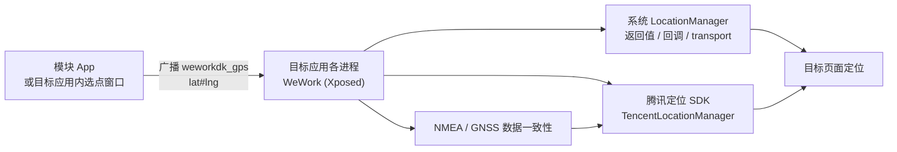

# LocationByWework

**企微打卡助手，一键修改定位。**

[](https://developer.android.com)
[](https://github.com/LSPosed/LSPosed)
[](CHANGELOG.md)
[](LICENSE)

一个基于 LSPosed 的 Android 定位调试模块，用于研究 Android 定位链路的工作方式：系统 `LocationManager` 的返回值与回调分发、NMEA 数据格式、第三方定位 SDK 的输出边界，以及 GCJ-02 / WGS-84 坐标系之间的转换关系。

安装模块并在 LSPosed 中勾选作用域后，在目标应用（Wework）内按「音量+」即可呼出腾讯地图选点窗口，选择坐标后立即生效，方便在测试环境中复现不同位置下的应用行为。

> [!NOTE]
> 本项目仅用于 Android Hook 技术、定位原理的学习与调试，请在合法合规、已获得授权的前提下使用。作者不对使用或滥用本项目产生的任何后果负责。

---

## 目录

- [功能特性](#功能特性)
- [工作原理](#工作原理)
- [环境要求](#环境要求)
- [安装](#安装)
- [使用](#使用)
- [构建](#构建)
- [项目结构](#项目结构)
- [实现要点](#实现要点)
- [日志与排查](#日志与排查)
- [常见问题](#常见问题)
- [已知限制](#已知限制)
- [免责声明](#免责声明)
- [致谢](#致谢)
- [许可证](#许可证)

## 功能特性

- **目标应用内嵌选点窗口**：不需要切换到模块 App，在地图窗口里完成选点与生效。
- **音量键快捷入口**：按「音量+」呼出（或恢复）窗口，「音量−」在窗口可见时隐藏；窗口未打开时「音量−」保持系统正常音量功能。
- **腾讯地图选点 + 地名搜索**：内嵌腾讯栅格地图，点击地图任意位置即选点；搜索框调用腾讯位置服务（周边 10 km）按关键字定位。
- **全精度坐标**：坐标以 `纬度#经度` 字符串经广播下发，进程内以 `double` 保存，避免 `float` 在 22.8° 附近约 0.2 m 的量化误差与多套键值不一致。
- **双通道接入**：同时覆盖系统 `LocationManager` 通道与目标应用内置腾讯定位 SDK（`.sapp.` 变体）通道，保证定位数据在两条链路上一致。
- **坐标系处理**：地图选点是 GCJ-02，原生 GPS/NMEA 域使用派生的 WGS-84，避免二次转换导致的数百米偏移。
- **环境一致性处理**：统一 mock 状态、精度、来源与卫星数；改写 NMEA 语句（RMC/GGA/GLL）并重算校验和；限制 GNSS 原始测量与导航电文注册，便于复现稳定的测试环境。
- **模块 App 备用能力**：手动输入经纬度、腾讯地图拾取坐标、照片路径注入、总开关，以及模块是否生效的自检提示。

## 工作原理



模块启动时 Hook `com.tencent.wework` 进程的 `Application.attach`，分四层工作：

| 层次 | 作用 |
| --- | --- |
| 配置层 | 接收 `weworkdk_gps` 广播，保存 GCJ-02 坐标并派生 WGS-84；同时持久化到 `hkWeWork` 首选项，供各进程重启后恢复 |
| 系统定位层 | 重写 `getLastLocation` / `getLastKnownLocation` / `getCurrentLocation` / `requestLocationUpdates` / `requestSingleUpdate`，并 Hook Android 16 的 `LocationManager$LocationListenerTransport`，把回调参数里的 `Location` 原位替换为配置点（兼容 `List<Location>` 与 LocationResult 类容器） |
| 腾讯 SDK 层 | 在 `TencentLocationManager` 的注册与返回值边界捕获 `TencentLocation`；混淆实现类无 setter 时，按其 getter（`getLatitude`/`getLongitude`/`getAccuracy`/`getProvider`）拦截；注册完成后主动用 SDK 缓存位置回调一次，消除首帧不一致 |
| 环境一致性层 | `isMock()`、`isFromMockProvider()`、蜂窝/WiFi 扫描结果、NMEA 语句、GNSS 原始测量与导航电文 |

### 坐标系约定

| 使用方 | 坐标系 | 说明 |
| --- | --- | --- |
| 腾讯地图选点 / 腾讯位置服务搜索 | GCJ-02 | 用户看到与选择的坐标 |
| 原生 `Location`（`provider=gps`）注入 | GCJ-02 | 与目标应用的定位比对约定一致，直接使用 |
| 腾讯定位 SDK `TencentLocation` getter | GCJ-02 | SDK 内部已完成转换，直接返回目标点 |
| NMEA 语句（RMC/GGA/GLL） | WGS-84 | 由 GCJ-02 迭代反算，SDK 解析后会再转回 GCJ-02 |

> 若把 GCJ-02 直接灌给「会按 WGS-84 再转换一次」的链路，在珠三角区域会产生约 600 m 的落点偏移，典型症状是「定位就在附近，但与目标点始终差一点」。

## 环境要求

| 项目 | 要求 |
| --- | --- |
| Android | 5.1（API 21）及以上，已在 Android 16 实机验证 |
| Root / 框架 | 已安装 LSPosed（Magisk / KernelSU 环境）；模块使用 Xposed API 53 编译 |
| 目标应用 | Wework Android 版；内部为「壳 + 动态容器」结构，类名与包名会随版本变化 |
| 模块包名 | `write.LocationGPS` |
| 构建 | JDK 17+、Android SDK 34、Gradle 8.9（Wrapper 已内置） |

> 本模块只保证 LSPosed 环境。VirtualXposed、太极、LSPatch 等非 root 方案未做适配与验证。

## 安装

1. 本仓库**不提供预编译 APK**：请按下方[构建](#构建)一节，配置自己的腾讯地图 key 后自行编译安装。
2. 安装后打开 **LSPosed 管理器 → 模块**，启用「定位助手」。
3. 进入模块的**作用域**设置，勾选目标应用（`com.tencent.wework`）。
4. 强制停止并重新打开目标应用（或重启手机）。
5. 打开模块 App，底部显示「插件已正常启动」表示 Hook 已生效。

> 升级模块后需要重新启动目标应用；调整坐标不需要重启，选点确认后立即生效。

## 使用

1. 保持目标应用在前台（建议停在需要定位的页面）。
2. 按 **音量+**，弹出地图选点窗口：
   - **地图点选**：直接点击地图，标记即目标坐标；
   - **地名搜索**：输入写字楼 / 小区 / 学校等关键字，点搜索结果直接定位；
   - 底部实时显示当前选中坐标（7 位小数）。
3. 点 **确认修改**，坐标通过广播同步到目标应用所有进程并立即生效。
4. 按 **音量−** 隐藏窗口（再次按音量+ 恢复）；窗口未打开时音量− 不拦截，正常调音量。
5. 回到需要定位的页面查看效果。

模块 App 中还保留了备用入口：手动输入经纬度保存、腾讯地图拾取、照片路径注入、总开关（关闭后所有 Hook 直接放行）。

## 构建

```bash
# 1. 配置腾讯地图 key（不要提交到仓库）
echo "tencent.map.key=你的腾讯地图key" >> local.properties

# 2. 跑单元测试
./gradlew :app:testDebugUnitTest

# 3. 构建 Debug APK
./gradlew :app:assembleDebug
# 产物：app/build/outputs/apk/debug/app-debug.apk

# Windows 使用 gradlew.bat
```

腾讯地图 key 申请：<https://lbs.qq.com/dev/console/key/manage>（需开启「WebServiceAPI」与「Android 地图 SDK」）。未配置 key 时项目仍可编译安装，但选点窗口内的地图与地名搜索不可用（搜索会提示未配置 key）。

签名：Release 构建请在 `app/build.gradle` 中补充 `signingConfigs`，或使用 Android Studio 的 **Build → Generate Signed Bundle / APK**。Debug 包可直接安装测试。

## 项目结构

```text
LocationByWework/
├── app/
│   ├── libs/TencentMapSDK_Raster_v_1.2.8.1.c02ec64.jar   # 腾讯栅格地图 SDK（纯 Java）
│   └── src/
│       ├── main/
│       │   ├── assets/xposed_init                       # Xposed 入口声明
│       │   ├── java/org/gallonyin/weworkhk/
│       │   │   ├── Main.java                # Xposed 入口：按包名分发
│       │   │   ├── WeWork.java              # 目标应用进程内 Hook 主体
│       │   │   ├── LocationFactory.java     # Location 构造与回调参数重写
│       │   │   ├── TencentSdkHooker.java    # 腾讯定位 SDK 输出边界处理
│       │   │   ├── VolumeKeyInjector.java   # 音量键入口（PhoneWindow 按键拦截）
│       │   │   ├── WeworkLocationPicker.java# 目标应用内选点窗口（地图 + 搜索）
│       │   │   ├── NmeaProxyFactory.java    # NMEA 监听器代理
│       │   │   ├── NmeaRewriter.java        # NMEA 坐标改写与校验和（纯 JVM）
│       │   │   ├── CoordConverter.java      # WGS-84 ↔ GCJ-02（纯 JVM）
│       │   │   ├── DeviceIdGuard.java       # 地图 SDK 读取 IMEI 的兜底
│       │   │   ├── CoordinateProvider.java  # 坐标提供者接口
│       │   │   ├── HookMethodArgsParser.java# findAndHookMethod 变参解析
│       │   │   ├── MainActivity.java        # 模块主界面
│       │   │   ├── TencentMapActivity.java  # 模块内腾讯地图拾取
│       │   │   └── Util.java                # 文件复制
│       │   └── res/                         # 布局、图标、主题
│       └── test/java/org/gallonyin/weworkhk/ # 纯 JVM 单元测试
├── imagepicker/                             # 图片选择（第三方库，照片注入功能使用）
├── images/                                  # 早期版本界面截图
├── gradle/                                  # Gradle Wrapper
├── build.gradle / settings.gradle
└── README.md / CHANGELOG.md / LICENSE
```

## 实现要点

工程中已经验证并固化的关键点，便于后续维护：

- **注入时机**：目标应用是「壳 + 动态容器」结构，`Application.attach` 阶段腾讯 SDK 类尚未加载，直接 `findClass` 必然失败。模块改为 `ClassLoader.loadClass` 懒触发 + 在 NMEA 注册、`requestLocationUpdates` 等热路径用监听器对象的真实 `classLoader` 重试安装。
- **SDK 变体**：目标应用内置的是 `com.tencent.map.geolocation.sapp.*`，方法名与标准 SDK 不同（缓存读取为 `getLastKnownLocation`），按标准 API 名写 Hook 会抛 `NoSuchMethodError`。
- **混淆实现类**：`TencentLocation` 实现类被混淆且没有 setter，原位改写失败时按类名去重后直接 Hook 其 getter。
- **首帧位置**：SDK 有磁盘缓存，打开页面会先渲染缓存位置；注册完成后立即用缓存对象推送一次配置坐标。
- **精度与来源**：真实对象携带 40–50 m 精度会让页面提示「精度较差」，因此 getter 与注入对象统一为 8 m 与 `provider=gps`。
- **NMEA 处理**：只 `return false` 会丢掉「正常 GPS」数据形态，高级 SDK 还会自行解析 NMEA，因此改为改写坐标并重算校验和后放行。
- **音量键拦截点**：选择 `PhoneWindow.superDispatchKeyEvent`，进程内所有 Activity/Dialog 的按键都会经过这里，不受目标应用覆写 `dispatchKeyEvent` 影响。
- **内嵌地图上下文**：`createPackageContext` 包装的 Context 在宿主进程里 `getApplicationContext()` 返回 `null`，需返回非空实现；地图 SDK 后台线程读取 IMEI 会因 `SecurityException` 杀掉进程，由 `DeviceIdGuard` 仅对地图 SDK 调用栈返回假值。

## 日志与排查

```bash
# 关键日志（XposedBridge.log 会同时写入 LSPosed 模块日志）
adb logcat -s WeWork Main

# LSPosed 模块日志（root）
adb shell su -c 'cat /data/adb/lspd/log/modules_*.log' | grep -E "hkGPS|callback rewrite|nmea|tencent|volume"
```

常用关键字：

| 关键字 | 含义 |
| --- | --- |
| `hkGPS: gcj=... wgs=...` | 当前生效的配置坐标（全精度） |
| `GPS updated process=... pid=...` | 广播同步成功及对应进程 |
| `callback rewrite status=... before=... after=...` | 系统回调中的坐标已替换 |
| `tencent sdk hooks installed` | 腾讯 SDK Hook 安装成功 |
| `tencent callback rewrite active` | 腾讯 SDK 回调已被改写 |
| `nmea listener wrapped` | NMEA 监听器已代理 |
| `raw gnss registration refused` | GNSS 原始测量注册已限制 |
| `volume key injector installed` | 音量键入口安装成功 |

## 常见问题

**按音量+ 没有反应？**
先确认目标应用进程内模块已注入（LSPosed 模块日志中应有 `hkStart`、`hkGPS`），并确认模块作用域勾选了目标应用。部分版本会重建窗口，弹窗 token 失效后会自动重建，可再按一次。

**窗口地图空白 / 搜索提示未配置 key？**
按[构建](#构建)一节在 `local.properties` 写入 `tencent.map.key` 后重新构建；搜索还需要手机能访问 `apis.map.qq.com`。

**坐标已同步但定位页没变化？**
多进程应用需要每个进程都收到广播。看日志里是否每个 PID 都有 `GPS updated process=...`；若只有部分进程，检查是否被厂商省电策略冻结，或重启目标应用后再试。

**位置短暂显示后又被刷新？**
说明走的是腾讯定位 SDK 通道，确认日志出现 `tencent sdk hooks installed` 与 `tencent callback rewrite active`。若目标应用升级后类名变化，需要按新版 SDK 重新适配。

**位置差几百米、与目标点对不上？**
通常是坐标系重复转换，确认选点坐标以 GCJ-02 注入原生 `Location`、NMEA 使用 WGS-84（见[坐标系约定](#坐标系约定)）。

**提示「定位精度较差」？**
真实对象的精度未被改写。确认 `getAccuracy` 返回 8 m 的 Hook 已安装。

**目标应用升级后失效？**
目标应用的类名、方法名、容器结构随版本变化，属于预期风险。可提 Issue 附上 Android 版本、目标应用版本与 LSPosed 模块日志。

## 已知限制

- 目标应用在前台时「音量+」被模块占用，语音/视频通话中无法用音量键调音量（可按音量− 或使用系统设置调节）。
- 依赖目标应用内部实现，**不能保证跨版本可用**；地图 SDK 为旧的 1.2.8.1 栅格版 jar。
- 只对定位、NMEA、GNSS 原始数据与部分网络定位输入做了处理，未做完整的设备指纹一致性；若目标应用新增检测手段需要继续适配。
- 双开 / 工作空间（多用户）、Android 模拟器等场景未验证。
- 照片注入依赖旧版存储路径与已废弃的 `targetSdkVersion`，仅作为历史功能保留，新系统上可能不可用。

## 免责声明

本项目为个人学习 Android Hook 与定位原理的实验性项目，代码按现状（AS IS）提供，不保证可用性、稳定性与合规性。

- 请仅在自己拥有合法权限的设备上安装、研究；
- 请遵守所在地法律法规与相关服务条款，勿将本项目用于任何不当用途；
- 使用本模块可能被目标应用或相关系统识别，相关风险由使用者自行承担；
- 项目作者不对使用或滥用本模块导致的任何直接或间接后果负责。

模块不采集、不上传任何个人数据；坐标仅保存在本机 SharedPreferences 中。除腾讯地图/位置服务请求外，模块不会主动联网。

## 致谢

定位调试与数据一致性处理的思路参考了 [HuangZhuoRui/LocationSpoofer](https://github.com/HuangZhuoRui/LocationSpoofer)，感谢作者分享。

## 许可证

[GNU General Public License v3.0](LICENSE)

```
Copyright (C) 2018-2026 gallonyin and contributors
```
